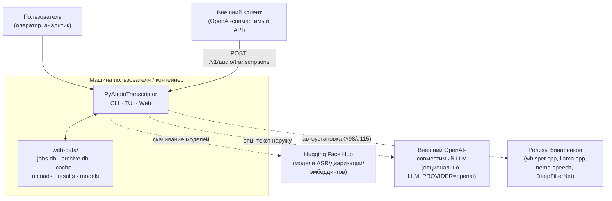
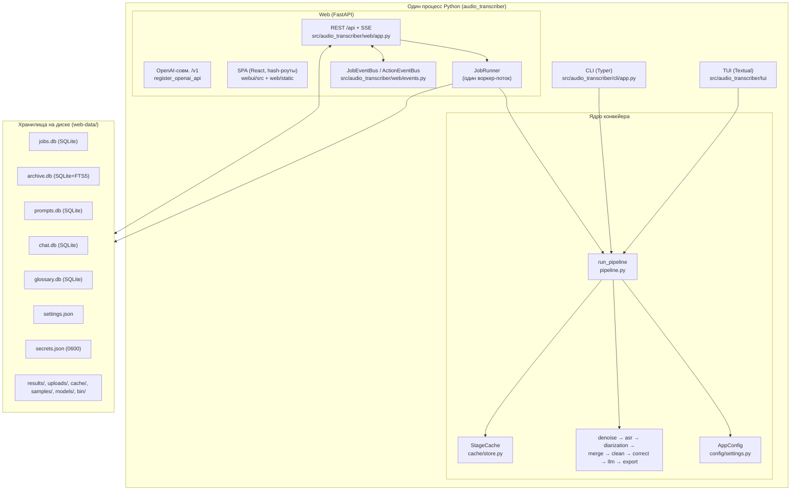

# Архитектура PyAudioTranscriptor

Статус: актуально на базе коммита `de13a58` (ветка `main`).
Источник фактов: исходный код `src/audio_transcriber/**`, `webui/src/**`,
`pyproject.toml`, `Dockerfile`, `docker-compose.yml`, `entrypoint.sh`,
`packaging/**`, `scripts/**`, `.github/workflows/**`, а также существующие
`README.md`, `docs/design/live-mode.md`, `CHANGELOG.md`, `TODO.md`.
Ссылки вида `path:line` указывают на конкретное место в коде.

> **Область документа.** Это описание *существующей* архитектуры. Единственное
> исключение — [`corporate-mode.md`](corporate-mode.md): там описан
> **проектируемый** многопользовательский режим (#134–#139), которого в коде
> ещё нет. Всё, что не подтверждено кодом, явно помечено как проект/допущение.

## 1. Назначение системы

PyAudioTranscriptor — **локальная** утилита для транскрибации аудиозаписей с
разделением говорящих (speaker diarization) и последующей обработкой текста
(очистка, автоисправление, LLM-постобработка, экспорт). Три способа работы на
одном ядре:

- **CLI** (`audio-transcriber transcribe ...`) — пакетный запуск;
- **TUI** (`audio-transcriber tui`) — интерактивный терминальный интерфейс;
- **Web** (`audio-transcriber web`) — локальный сервер FastAPI + React SPA
  (по умолчанию `127.0.0.1`).

Точки входа зарегистрированы в `pyproject.toml:26` (`audio-transcriber =
"audio_transcriber.cli.app:app"`) и как `python -m audio_transcriber`
(`src/audio_transcriber/__main__.py:1`).

## 2. Контекст (C4 level 1)

Внешние зависимости времени выполнения: внешние бинарники `whisper-cli`,
`llama-server`, `nemo-speech`, `deep-filter` (регистрируются в
`src/audio_transcriber/web/assets.py`), локальные модели Hugging Face
(`src/audio_transcriber/models/catalog.py`), опционально внешний LLM
(`LLM_PROVIDER=openai`, `src/audio_transcriber/llm/client.py:9`).

## 3. Контейнеры (C4 level 2)

Один Python-процесс объединяет CLI/TUI/Web. Web-контейнер внутри процесса
содержит FastAPI-приложение, один фоновый воркер очереди и SQLite-хранилища.

Слои конфигурации: `config.env` → `web-data/settings.json` → CLI-флаги →
`AppConfig` (см. [`configuration.md`](configuration.md)).

## 4. Слои, полные карты и детали

| Документ | О чём |
|---|---|
| [`components.md`](components.md) | Карта пакетов/модулей, протоколы (`SpeechRecognizer`, `SpeakerDiarizer`, …) и их реализации |
| [`pipeline.md`](pipeline.md) | Конвейер: стадии, кэш стадий, прогресс/отмена, поток данных `TranscriptionResult` |
| [`engines.md`](engines.md) | Движки ASR и диаризации: выбор (`auto`), устройство, enrollment, ограничения |
| [`web.md`](web.md) | Веб-слой: FastAPI, роуты, SSE, очередь, хранилища, SPA, `/v1`, CSRF/auth |
| [`configuration.md`](configuration.md) | Слои конфигурации, каталог/скачивание моделей, `doctor`, ключи/секреты |
| [`packaging.md`](packaging.md) | Точки входа, Docker, portable one-dir, инсталляторы, CI/релизы |
| [`corporate-mode.md`](corporate-mode.md) | **Проект** многопользовательского режима (швы auth/скоупинг/RBAC/SSO) |
| [`decisions.md`](decisions.md) | ADR: ключевые архитектурные решения и их причины |

## 5. Инварианты архитектуры

Наблюдения из кода, которые неочевидны и определяют конструкцию:

1. **Единый протокол-барьер.** Каждая стадия общается с остальным кодом через
   `typing.Protocol`: `SpeechRecognizer` (`transcription/base.py:17`),
   `SpeakerDiarizer` (`diarization/base.py:19`), `SegmentMerger`
   (`merging/base.py:16`), `DenoiserProtocol` (`denoising/base.py:16`),
   `TextCorrector` (`correction/base.py:11`), `ResultExporter`
   (`export/base.py:12`), `LlmClient` (`llm/base.py:10`). Это позволяет
   подменять движки, не меняя конвейер (и используется в тестах:
   `pipeline.py:6-7`).
2. **Строго последовательный конвейер.** Диаризация стартует только после
   завершения ASR (`pipeline.py:627-733`); параллелизма стадий нет.
3. **Один воркер.** Задачи обрабатываются строго по одной, потому что ASR и
   диаризация конкурируют за GPU/CPU (`runner.py:1-8`, `runner.py:152`).
4. **Постадийный кэш с версиями.** Ключ — SHA-256 от (версия формата, стадия,
   идентичность файла, параметры) (`cache/store.py:41`); версии реализаций
   движков входят в ключ (`pipeline.py:359`, `446` и др.).
5. **Мягкая деградация.** Сбой необязательных компонентов (денойз, LLM,
   диаризация, enrollment) логируется и не роняет прогон
   (`pipeline.py:82`, `967`; `diarization/nemo_speech_engine.py:26-30`).
6. **Локальность и отсутствие аутентификации SPA.** Сервер поднимается на
   `127.0.0.1` (`web/app.py:3`, `cli/app.py:1413`), у SPA-API нет логина —
   только CSRF-защита от межсайтовых запросов (`web/app.py:908`).

## 6. Глоссарий

- **ASR** — automatic speech recognition, распознавание речи.
- **Диаризация** — определение «кто когда говорил» (без текста).
- **Enrollment** — сопоставление говорящего с именем по образцу голоса
  (`diarization/enrollment.py:1`).
- **Стадийный кэш** — кэш результатов дорогих стадий (денойз, ASR,
  диаризация) на диске (`cache/store.py:58`).
- **Протокол (в проекте)** — не только «протокол встречи» (стенограмма +
  резюме, `protocol.py:1`), но и `typing.Protocol`-контракт компонента.
- **Движок** — конкретная реализация протокола (например,
  `WhisperCppRecognizer` для `SpeechRecognizer`).
- **Bare minimum / MVP** — минимально достаточный объём фичи; используется в
  проектном документе [`corporate-mode.md`](corporate-mode.md).
- **Скоупинг** — ограничение видимости данных владельцем (проект, corp-режим).
- **Хотвайр** — список «горячих» терминов/слов для ASR (`HOTWORDS`,
  `utils/hotwords.py`).

## 7. Связанные внешние документы (не дублируем)

- `README.md` — пользовательская документация (установка, запуск, Docker,
  конфигурация, раздел «Архитектура» с sequence-диаграммой).
- `docs/design/live-mode.md` — дизайн потокового live-режима (#44), **ещё не
  реализован**.
- `docs/qa/web-ui-test-cases.md` — тест-кейсы web-UI.
- `CHANGELOG.md` — история изменений (semver через git-теги).
- `TODO.md` — разделы «Желательно» и «Корпоративная версия».
