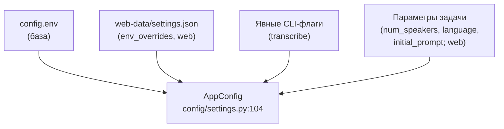

# Конфигурация, модели и самопроверка

Навигация: [Обзор](README.md) · [Компоненты](components.md) · [Конвейер](pipeline.md) ·
[Движки](engines.md) · [Веб](web.md) · [Упаковка](packaging.md) ·
[Корп-режим](corporate-mode.md) · [ADR](decisions.md)

## 1. Слои конфигурации

Единый источник настроек — **`config.env`** (файл формата `КЛЮЧ=значение`, не
попадает в git). Поверх него накладываются: настройки веб-UI
(`web-data/settings.json`), затем явные CLI-флаги, затем параметры конкретной
задачи. Итог всегда собирается в `AppConfig`.

- **`config.env`** ищется сначала в рабочем каталоге (`cwd`), затем рядом с
  проектом/пакетом (`utils/config_env.py:71-108`). Разбор — мягкий: неизвестные
  значения булевых дают `default` (`parse_bool`, `:24`).
- **CLI** переносит в `AppConfig` только **явно заданные** опции
  (`_explicit_overrides`, `cli/app.py:155`); остальные приходят из `config.env`
  через `collect_env_kwargs` (`cli/app.py:17`). Карта «имя опции → поле» —
  `_PARAM_TO_FIELD` (`:117`).
- **Web** НЕ читает CLI-флаги: для каждой задачи `build_job_config` берёт
  `env_defaults()` (это `config.env`) и накладывает `settings.env_overrides()`
  (`web/config.py:187-213`; метод `env_overrides` — `web/settings.py:174-236`).
  Пустые значения пропускаются — действует значение из `config.env`.
- **Параметры задачи** (web) довлеют над настройками: `num_speakers`/
  `min_speakers`/`max_speakers`, а также `language` и `initial_prompt`
  (для задач из OpenAI-API) копируются в конфиг перед прогоном
  (`web/runner.py:380-391`).

### 1.1. `AppConfig` — группы полей

`AppConfig` (`config/settings.py:104`) — большой dataclass. Группы:

| Группа | Примеры полей |
|---|---|
| Ввод/вывод | `input_file`, `output_dir`, `export_formats` |
| ASR | `model_name`, `language`, `device`, `asr_backend`, `whisper_cpp_*`, `gigaam_*`, `hybrid_*`, `word_timestamps` |
| Диаризация | `diarization_enabled/engine`, `num/min/max_speakers`, `nemo_speech_*`, `diarization_estimate_*`, `diarization_hybrid_*`, `diarization_sherpa_*`, `pyannote_local_model` |
| Enrollment | `speaker_names`, `speaker_references`, `voices_dir`, `enrollment_*`, `reference_prepare` |
| Merge/clean | `mark_overlap`, `merge_same_name_speakers`, `sentence_merge_max_gap`, `clean_artifacts`, `collapse_repeats`, `normalize_text` |
| Correction | `enable_correction`, `correction_*` |
| LLM | `llm_enabled/provider/base_url/model_name/api_key/model/binary`, `llm_summary`, `llm_summary_prompt`, `llm_extract_names`, `llm_correct_semantic`, `llm_semantic_min_confidence` |
| Прочее | `denoise`, `deep_filter_binary`, `use_cache`/`cache_dir`, `notifications`, `timeline`, `protocol_auto`, `low_confidence_threshold`, `glossary_*` |

Ряд полей финализируется методами-нормализаторами (`resolved_cache_dir`,
`resolved_speaker_references`, `resolved_glossary_db`, `ensure_output_dir`).

### 1.2. Значения по умолчанию

Все не-подсистемные дефолты и допустимые значения — в `config/defaults.py`
(пороги диаризации, лимит Sortformer, модели nemo/sherpa, linkage/threshold и
т.д.). Он не импортирует подсистемы (инверсия зависимостей,
`config/defaults.py:1-6`).

## 2. Каталог и скачивание моделей

### 2.1. Каталог

`MODEL_CATALOG` (`models/catalog.py:64`) описывает известные модели и куда их
класть (`ModelEntry`, `:36`). Записи:

| id | kind | Что | target_dir | setting_key |
|---|---|---|---|---|
| `whisper-large-v3-turbo` | whisper | ggml large-v3-turbo | `whisper-models` | `whisper_cpp_model` |
| `whisper-large-v3` / `medium` / `small` / `base` | whisper | прочие ggml | `whisper-models` | `whisper_cpp_model` |
| `qwen2.5-7b-instruct-q4_k_m` | llm | GGUF (2 шарда) | `llama-models` | `llm_model` |
| `pyannote-community-1` | pyannote | gated snapshot | `pyannote-models/...` | `pyannote_local_model` |
| `gigaam-v3-onnx` | gigaam | snapshot ONNX | `gigaam-models/...` | `gigaam_model_path` |
| `sherpa-campplus-advanced` | sherpa | CAM++ ONNX | `sherpa-models` | `diarization_estimate_model` |

Модели кладутся в `<каталог моделей>/<target_dir>`, если в настройках не задан
явный путь (`models/catalog.py:62-63`). Gated-модель pyannote требует токен HF и
принятые условия (`:142-145`).

### 2.2. Механизм скачивания

- `HfDownloader` (`models/download.py:104`) — загрузка с Hugging Face;
  `ModelDownloadManager` (`:272`) управляет загрузками, `DownloadBus` (`:175`)
  публикует прогресс; скачивание можно отменить (`DownloadCancelled`, `:47`).
- **Web:** `GET /api/models` (каталог + локальный статус), SSE
  `/api/models/events`, `POST /api/models/{id}/download`, `/cancel`,
  `DELETE /api/models/{id}` (`web/app.py:2185-2276`); целевой путь —
  `resolve_target(...)` + `local_status` (`models/catalog.py:264`).
- **CLI:** подкоманда `models` (`cli/models_cmd.py`), в т.ч.
  `audio-transcriber web --download-models` (`cli/app.py:1438-1458`) —
  идемпотентно скачивает недостающие модели, gated без токена пропускает.
- Модель nemo-speech тянется отдельным механизмом `nemo-speech pull`
  (`web/nemo_speech.py`, эндпоинты `/api/diarization/nemo-speech/model/*`).
- Внешние бинарники (`whisper-cli`, `llama-server`, `nemo-speech`,
  `deep-filter`) ставятся отдельным реестром с проверкой sha256
  (`web/assets.py:220-418`, эндпоинты `/api/assets/*`).

## 3. Секреты и ключи (`web/secrets.py`)

- `SecretsStore` хранит секреты в `web-data/secrets.json` с правами **0600**
  (`web/paths.py:83-85`).
- Токен Hugging Face (`HF_TOKEN`) нужен для gated-моделей pyannote/nemo;
  `effective_hf_token` объединяет файл секретов, `config.env` и окружение, а
  `mask_hf_token`/`mask_secret` отдают маску для UI (`web/app.py:1538-1543`).
- `LLM_API_KEY` — ключ внешнего LLM (`LLM_PROVIDER=openai`), `effective_llm_api_key`.
- `API_KEY` — ключ доступа OpenAI-совместимого `/v1`; генерируется в UI
  (префикс `sk-`, минимум 16 символов, `web/app.py:352-356`) либо задаётся
  `API_KEY` в `config.env`. Эффективный ключ — `effective_api_key`, проверка —
  `hmac.compare_digest` (`web/app.py:1190`).

> **Auth-заготовки.** В коде **нет** `AUTH_MODE`/SAML/OIDC/RBAC — это только
> проект корпоративного режима ([`corporate-mode.md`](corporate-mode.md)).
> Реально существующие «ключи» — `API_KEY` (для `/v1`), `HF_TOKEN`,
> `LLM_API_KEY`; а также мягкая CSRF-проверка SPA (см. [`web.md`](web.md#7-csrf-и-auth-заготовки)).

## 4. `doctor` — самопроверка окружения

`doctor.py` реализует `run_doctor` / `format_report` / `has_critical_failures`
(`:42-48`) и вызывается командой `audio-transcriber doctor`
(`cli/app.py:1331-1349`, код возврата 1 при критичных сбоях). Проверки быстрые,
без загрузки моделей и тяжёлых вычислений (`doctor.py:1-13`):

- версия Python (минимум `(3, 12)`, `:53`), ключевые зависимости;
- внешние бинарники (`whisper-cli`, `llama-server`, `nemo-speech`, `deep-filter`);
- модели и каталоги;
- наличие GPU-Vulkan;
- `config.env`, токен HF (значение не печатается), доступность на запись
  каталогов результатов и кэша.
- Каждый пункт помечен «критичностью»; отсутствие опционального компонента — не
  фатально (`:10-12`).

Web переиспользует доктора: `GET /api/setup`, `GET /api/doctor`, POST
`/api/doctor/recheck`, `/api/doctor/hf-check` (`web/app.py:1650-1674`), с
кратковременным кэшем отчёта `DoctorReportCache` (`:766`). Шаг «мастер первого
запуска» собирается `build_setup_steps` (`web/setup.py:216-252`).

## 5. Часто используемые переменные `config.env`

Канонический список — `config.example.env` (большой, с комментариями) и раздел
«Конфигурация `config.env`» в `README.md:1609`. Краткая карта по подсистемам:

| Подсистема | Переменные (выборка) |
|---|---|
| ASR | `ASR_BACKEND`, `MODEL`, `DEVICE`, `WHISPER_CPP_*`, `GIGAAM_*`, `HYBRID_*`, `INITIAL_PROMPT`, `HOTWORDS`, `WORD_TIMESTAMPS` |
| Диаризация | `DIARIZATION_ENABLED`, `DIARIZATION_ENGINE`, `NUM_SPEAKERS`/`MIN/MAX_SPEAKERS`, `NEMO_SPEECH_*`, `DIARIZATION_ESTIMATE_*`, `DIARIZATION_ROUTE_MAX_SPEAKERS`, `DIARIZATION_HYBRID_*`, `DIARIZATION_SHERPA_*`, `PYANNOTE_LOCAL_MODEL` |
| Enrollment | `VOICES_DIR`, `ENROLLMENT_*`, `REFERENCE_*` |
| Merge/clean | `MARK_OVERLAP`, `MERGE_SAME_NAME_SPEAKERS`, `SENTENCE_MERGE_MAX_GAP`, `CLEAN_ARTIFACTS`, `COLLAPSE_REPEATS`, `NORMALIZE_TEXT` |
| Денойз | `DENOISE`, `DEEP_FILTER_BINARY` |
| LLM | `LLM_ENABLED`, `LLM_PROVIDER`, `LLM_BASE_URL`, `LLM_MODEL_NAME`, `LLM_API_KEY`, `LLM_MODEL`, `LLM_BINARY`, `LLM_SUMMARY`, `LLM_SUMMARY_PROMPT`, `LLM_CONTEXT`, `LLM_CORRECT_SEMANTIC` |
| Кэш/вывод | `USE_CACHE`, `CACHE_DIR`, `OUTPUT_DIR`, `EXPORT_FORMATS`, `TIMELINE`, `PROTOCOL_AUTO`, `NOTIFICATIONS` |
| Глоссарий | `GLOSSARY_ENABLED`, `GLOSSARY_DB`, `GLOSSARY_PATH` |

Часть этих переменных редактируется в веб-UI и хранится в `settings.json`
(`web/settings.py:78-168`), а не в `config.env`.

## 6. Известные ограничения конфигурации

- Веб-сервер читает `LLM_API_KEY`/`API_KEY` из `config.env` или UI, но **не** из
  process env (`docker-compose.yml`, комментарий у `LLM_API_KEY`).
- `AUDIO_TRANSCRIBER_WEB_DATA` переопределяет каталог данных
  (`web/paths.py:19`), `AUDIO_TRANSCRIBER_MODELS_DIR` — каталог моделей (`:22`).
- `OPENAI_TIMEOUT` — таймаут синхронного `/v1` (`web/app.py:1004-1007`).
