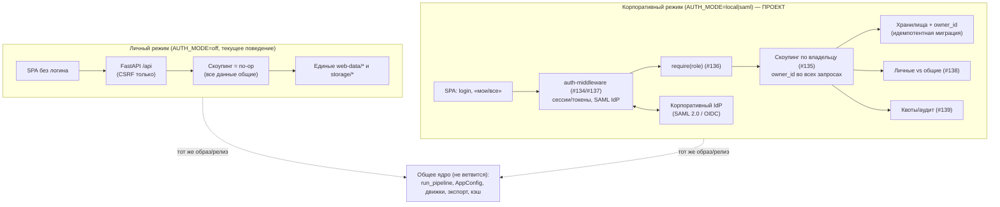

# Корпоративный режим (проект, #134–#139)

Навигация: [Обзор](README.md) · [Компоненты](components.md) · [Конвейер](pipeline.md) ·
[Движки](engines.md) · [Веб](web.md) · [Конфигурация](configuration.md) ·
[Упаковка](packaging.md) · [ADR](decisions.md)

> ⚠️ **Статус: ПРОЕКТ.** В коде корпоративного режима **нет**. Фактическое
> состояние — однопользовательский локальный сервер без аутентификации SPA
> (`TODO.md:745-746`). Ниже описаны предлагаемые **швы** и их места в текущей
> архитектуре. Всё, что не подтверждено кодом, помечено как проект/допущение.

## 1. Решение и границы

**Решение (из `TODO.md:718-724`):** корпоративный режим — это **режим того же
проекта**, а не отдельный продукт/ветка/пакет. Один репозиторий, одно ядро
(`pipeline.py` и стадии). Корп-возможности включаются **конфигом**
(напр. `AUTH_MODE=off|local|saml`); по умолчанию **выключено** → личный режим
работает как сейчас. Слой живёт в предполагаемом `web/auth/`. **Ядро по режиму
не ветвится**; релизы/CI общие. Связано с #55 (вывод сервера в сеть).

Ключевой принцип: **узкие сквозные швы**, а не переписывание. Ядро конвейера
уже изолировано протоколами и `AppConfig` (см. [`components.md`](components.md)),
поэтому корп-изменения сосредоточены в веб-слое и хранилищах.

## 2. Диаграмма: личный и корпоративный режимы

## 3. Сквозные швы и их места в текущем коде

### 3.1. Auth-middleware (#134, #137)

- **Сейчас:** `create_app` ставит только CSRF-middleware `csrf_guard`
  (`web/app.py:908`); для `/v1` есть строгий Bearer-ключ (`:1171`), для SPA —
  ничего.
- **Проект:** отдельный middleware аутентификации в `web/auth/`; `AUTH_MODE=off`
  — no-op. Точка врезки — рядом с `csrf_guard`; для `/v1` поведение с Bearer
  сохраняется (API-ключ может стать отдельной сущностью на пользователя).
- **Сессии/токены:** cookie-сессия или токен SPA↔API; logout/истечение.
- **SAML/OIDC:** вход через корпоративный IdP, маппинг атрибутов
  (логин/имя/группы) в пользователя и роли. Внешняя сущность → EIF.

### 3.2. Владение и скоупинг (#135)

- **Сейчас однодоменность:** один каталог данных `web-data/`
  (`web/paths.py:29`); в `jobs.db` **нет** поля владельца
  (`web/storage/jobs_db.py:163-197`); `results/`, `uploads/`, `samples/`,
  `cache/` — общие; `archive.db`/`chat.db`/`prompts.db` — общие
  (см. [`web.md`](web.md#5-хранилища)).
- **Проект:** поле `owner_id` + фильтрация во всех эндпоинтах. Инфраструктура
  миграций уже есть: `JobsDB._migrate` идемпотентно добавляет колонки
  (`web/storage/jobs_db.py:307-333`), `ArchiveDB` версионирует схему через
  `PRAGMA user_version` (`storage/archive_db.py:256-264`).
- **Скоупинг как no-op в личном режиме** — единая функция/фильтр, которая в
  `AUTH_MODE=off` не сужает выдачу. Это сохраняет текущее поведение.

### 3.3. RBAC (#136)

- **Сейчас:** нет понятия роли; настройки/модели/бинарники доступны всем.
- **Проект:** зависимость `require(role)` (admin/user) на группы роутов:
  настройки, модели, бинарники, чужие записи, управление пользователями.
  Врезка — `Depends(...)` в `register_api` (`web/app.py:1315`) и в
  `register_*_routes` (glossary/prompts/chat/archive).

### 3.4. Сеть, CORS, CSRF (#137)

- **Сейчас:** bind на `127.0.0.1` (`cli/app.py:1413`); CORS не нужен — один
  origin (`web/app.py:10`); CSRF — мягкая проверка (`:908`).
- **Проект:** bind на сетевой интерфейс, TLS, CORS-политика для
  multi-user, усиление CSRF/Origin.

### 3.5. Личные vs общие ресурсы (#138)

- **Сейчас** весь глоссарий/голоса/промпты — глобальные
  (`storage/glossary_db.py`, `voices/`, `storage/prompts_db.py`).
- **Проект:** личные и общие наборы, права на изменение/шаринг, учёт владельца.

### 3.6. Квоты, лимиты, аудит (#139)

- **Сейчас:** одна очередь — один воркер (`web/runner.py:152`), без лимитов и
  журнала.
- **Проект:** лимиты на пользователя (диск/часы/параллельные задачи), журнал
  действий (кто запускал/менял/удалял), приоритеты в общей очереди.

## 4. Карта задач

| Задача | Тема | Шов | Затрагивает |
|---|---|---|---|
| #134 | Аутентификация и SSO (SAML/OIDC) | auth-middleware | `web/app.py`, новый `web/auth/` |
| #135 | Разделение записей по пользователям | владение + скоупинг | `web/storage/jobs_db.py`, `storage/*`, `web/paths.py`, все эндпоинты |
| #136 | Роли и права (RBAC) | `require(role)` | `register_api`, `register_*_routes` |
| #137 | Сессии/токены, защита API/SPA, вывод в сеть | сессии + CORS/TLS/bind | `create_app`, `cli/app.py` |
| #138 | Общие vs личные ресурсы | владение ресурсами | глоссарий/голоса/промпты |
| #139 | Квоты, лимиты и аудит | квоты + журнал | `JobRunner`, хранилища |

## 5. Инварианты, которые нельзя нарушать

1. **Ядро не ветвится по режиму.** `run_pipeline`/движки/экспорт не знают о
   пользователях; скоупинг и RBAC живут в веб-слое и хранилищах.
2. **`AUTH_MODE=off` = текущее поведение** (личный режим): скоупинг — no-op,
   middleware не мешает.
3. **Идемпотентные миграции** схем (образец уже есть: `JobsDB._migrate`,
   `ArchiveDB` `user_version`).
4. **Общие SHARED-ресурсы остаются доступными** там, где это задумано
   (глоссарий/голоса/промпты), но с явными правами.

## 6. Bare-minimum оценка сложности (анализ)

Оценка — только для **минимально достаточного** корп-режима, без пост-MVP
надстроек. Без сроков; story points — относительная сложность.

### 6.1. WBS — задача на существующем проекте (bare minimum)

| Раздел | Элементы (минимум) | MVP-фильтр |
|---|---|---|
| 1.0 DIRECT_IMPACT_SCOPE | auth-middleware; скоупинг по владельцу; `require(role)`; поля `owner_id`/роли | все нужны для MVP |
| 2.0 REQUIRED_CHANGES | миграции схем; фильтрация эндпоинтов; login/«мои-все» в SPA | нужны |
| 3.0 DEPENDENCY_CHAIN | SAML IdP (внешний); session store; порядок middleware/роутов | нужны |
| 4.0 RISK_MITIGATION | фича-флаг `AUTH_MODE`; no-op-скоупинг; откат флагом | нужны |

Фilter-вопросы: бизнес-критично для MVP? да. Нельзя отложить? да. Требует
архитектурного решения сейчас? да (поле владельца и middleware). Блокирует
ядро? нет (деградирует в личный режим).

Пост-MVP (не в bare minimum): #138 (общие/личные наборы), #139 (квоты/аудит),
приоритеты очереди.

### 6.2. Use Case Points (только essential)

| Use case | Вес |
|---|---|
| UC1 Вход через SSO/local | Average (10) |
| UC2 Просмотр «моих» задач/результатов | Average (10) |
| UC3 Запуск обработки (со скоупингом) | Average (10) |
| UC4 Управление пользователями/ролями (admin) | Average (10) |

- Акторы (primary): Пользователь (Average=2), Администратор (Complex=3);
  IdP — внешняя система (Average=2). `UAW = 7`.
- `UUCW = 40`; `UCP = 47`.
- TCF (только критичные факторы): распределённость/внешний IdP и требования
  переиспользования (одно ядро) → умеренное влияние, `TCF ≈ 1.0`.
- EF (только команда + зрелость инструментов): `EF ≈ 0.9–1.0`.
- Итог: `≈ 42–47 UCP`.

### 6.3. T-shirt (bare minimum)

- **Корп-минимум** (auth + скоупинг + RBAC + сеть/сессии): **L** (14–20
  story points) — меняется архитектура веб-слоя и модели данных.
- Каждый пост-MVP блок отдельно: #138 — **M** (9–13), #139 — **M** (9–13).

### 6.4. Function Points (essential)

| Тип | Элементы (минимум) |
|---|---|
| EI | вход/SSO, создание задачи (со скоупингом), управление пользователем, смена роли |
| EQ | список «моих» задач, список пользователей (admin) |
| EO | — (аудит-экспорт — пост-MVP, #139) |
| ILF | пользователи/роли, сессии; `owner_id` в задачах/архиве/чате/голосах |
| EIF | метаданные IdP (SAML/OIDC) |

Ауксилиарные функции (отчёты, админ-UI, экспорт журнала) — пост-MVP.

## 7. Фазы поставки (Hot Deployment, проект)

> Формат — предложение по фазам; сроки не оцениваются. Стратегия деплоя —
> **Feature Flags** (`AUTH_MODE`), потому что изменение сквозное, а откат должен
> быть мгновенным; `AUTH_MODE=off` по умолчанию сохраняет личный режим.

## PHASE 1: AUTH_CORE - Скелет режима и вход

`jira/CORP-1` Конфиг-флаг режима `AUTH_MODE=off|local|saml` + no-op middleware
**Description:**
• Ввести `AUTH_MODE` (по умолчанию `off`) в слои конфигурации; middleware-заглушка в `web/auth/`
• Продакшн-мониторинг: `/api/health` и логи входа; порог ошибок аутентификации
**Blocks:**
└─ jira/CORP-2 Зависит от конфиг-слоя
└─ jira/CORP-3 Зависит от no-op middleware

`jira/CORP-2` Локальная аутентификация и cookie-сессия
**Description:**
• Логин/логаут, срок жизни сессии, защита SPA-роутов; при `AUTH_MODE=off` — не активна
• Совместимость с существующим CSRF (`csrf_guard`) и Bearer `/v1`
• Риск-митигация: фича-флаг; откат возвращает личный режим
• Нулевой простой: новые роуты добавляются, старые не меняются
• Пользовательская ценность: вход в защищённый UI
**Blocks:**
└─ jira/CORP-1 Скелет режима
└─ jira/CORP-4 Внешний IdP (SAML)

`jira/CORP-3` Владение: `owner_id` + скоупинг (no-op в личном режиме)
**Description:**
• Идемпотентные миграции (`JobsDB._migrate`, `ArchiveDB.user_version`): поле владельца
• Единый фильтр скоупинга во всех эндпоинтах; в `AUTH_MODE=off` не сужает выдачу
• Риск-митигация: миграция аддитивна, обратно совместима
• Нулевой простой: старая логика читает те же строки
• Пользовательская ценность: изоляция данных (включается флагом)
**Blocks:**
└─ jira/CORP-1 Скелет режима
└─ jira/CORP-5 RBAC

`jira/CORP-4` SAML/OIDC через корпоративный IdP
**Description:**
• Маппинг атрибутов (логин/имя/группы) → пользователь/роли; внешний блокер — настройки IdP
• Критерий снятия блокера: валидные метаданные IdP доступны
• Откат: `AUTH_MODE` обратно на `local`/`off`
• Пользовательская ценность: единый вход
**Blocks:**
└─ jira/CORP-2 Локальная аутентификация

## PHASE 2: ACCESS_CONTROL - Роли и вывод в сеть

`jira/CORP-5` RBAC `require(role)` на группы роутов
**Description:**
• admin/user: настройки, модели, бинарники, управление пользователями, чужие записи
• Критический путь: **Blocks Phase Completion**
• Нулевой простой: при роли по умолчанию поведение личного режима сохраняется
**Blocks:**
└─ jira/CORP-3 Владение/скоупинг

`jira/CORP-6` Сеть: bind/TLS/CORS, усиление CSRF для multi-user
**Description:**
• Вывод сервера в сеть с TLS; политика CORS для SPA↔API
• Мониторинг: алерты по 401/403 и отказам Origin
• Откат: возврат bind на localhost
**Blocks:**
└─ jira/CORP-1 Скелет режима

## PHASE 3: RESOURCES_AND_LIMITS - Пост-MVP (#138, #139)

`jira/CORP-7` Личные и общие ресурсы (глоссарий/голоса/промпты)
**Description:**
• Владелец ресурса, права на изменение/шаринг, общие наборы
• Только после стабильного скоупинга задач
**Blocks:**
└─ jira/CORP-3 Владение/скоупинг

`jira/CORP-8` Квоты и аудит
**Description:**
• Лимиты на пользователя (диск/часы/параллельные задачи), журнал действий
• Приоритеты в общей очереди (сейчас один воркер)
**Blocks:**
└─ jira/CORP-5 RBAC
└─ jira/CORP-6 Сеть

## 8. Допущения и открытые вопросы

- **Допущение:** SAML 2.0 достаточно; OIDC/OAuth2 — «при необходимости»
  (`TODO.md:726-727`). Точный IdP и маппинг групп неизвестны.
- **Открыто:** где хранить сессии (SQLite/Redis/подписанные cookie) — не
  определено.
- **Открыто:** оставить ли единый `web-data/` с фильтрацией или разнести данные
  по владельцам физически.
- **Открыто:** модель ролей (только admin/user или более гранулярная).
- **Не оценивалось:** требования безопасности/аудита корпоративного контура
  (внешние регламенты) — могут увеличить объём.
