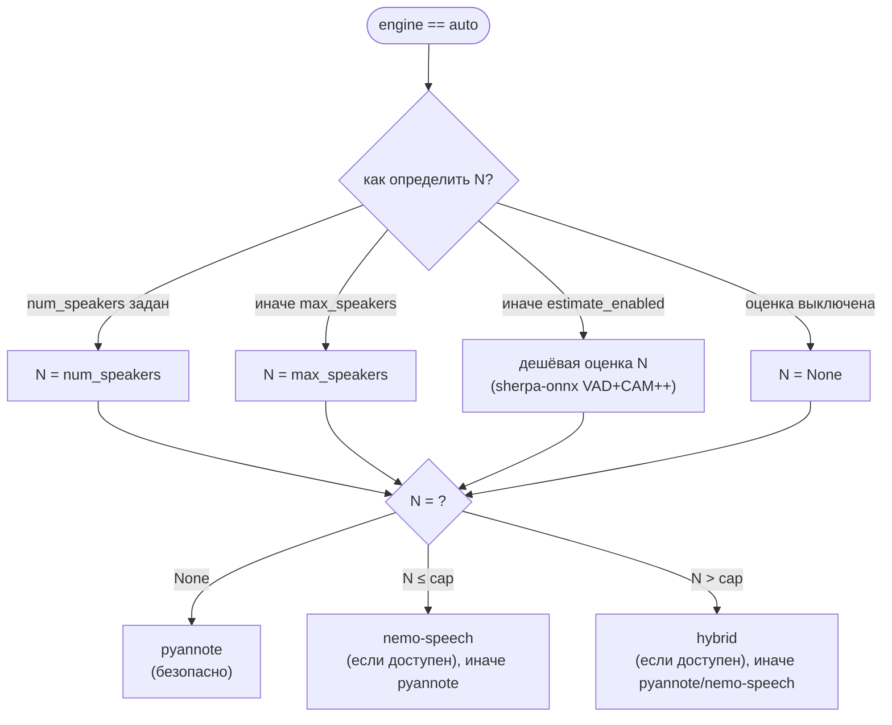

# Движки ASR и диаризации

Навигация: [Обзор](README.md) · [Компоненты](components.md) · [Конвейер](pipeline.md) ·
[Веб](web.md) · [Конфигурация](configuration.md) · [Упаковка](packaging.md) ·
[Корп-режим](corporate-mode.md) · [ADR](decisions.md)

Все движки подключаются через протоколы `SpeechRecognizer` и `SpeakerDiarizer`
(см. [`components.md`](components.md)), поэтому конвейер их не различает.
Ключи постадийного кэша описаны в [`pipeline.md`](pipeline.md#3-постадийный-кэш);
ниже — что именно влияет на выбор и результат.

## 1. ASR (распознавание речи)

Выбор бэкенда — `AsrBackend` (`domain/enums.py:16`):
`faster-whisper` (по умолчанию), `whisper-cpp`, `gigaam`. Сборка движка —
`_build_single_recognizer` (`pipeline.py:211`), обёртка гибридом —
`_build_recognizer` (`pipeline.py:264`).

### 1.1. faster-whisper

- Реализация: `WhisperSpeechRecognizer` (`transcription/whisper_engine.py:18`).
- Зависимость `faster-whisper` (`pyproject.toml:12`), работает через PyTorch;
  устройство — `Device` (`auto`/`cpu`/`cuda`, `domain/enums.py:8`).
- Модель — `MODEL` (по умолчанию `large-v3-turbo`, `web/config.py:230`).
- Пословные таймстемпы — из `segment.words` (`whisper_engine.py:31-32`).
- **Ограничение:** на «старых» AMD (Polaris/RX 4xx–5xx) CUDA/ROCm недоступны —
  GPU-ускорения через torch нет (см. `docs/design/live-mode.md:22-24`).

### 1.2. whisper.cpp (`whisper-cpp`)

- Реализация: `WhisperCppRecognizer` (`transcription/whisper_cpp_engine.py:868`).
- Запускает внешний бинарник `whisper-cli` и разбирает JSON-вывод
  (`whisper_cpp_engine.py:1-9`). GPU — через **Vulkan**, поэтому работает и на
  AMD без ROCm.
- **Чанкинг длинных файлов.** whisper.cpp накапливает текстовый контекст между
  30-с окнами и на длинной записи теряет речь/галлюцинирует. Длинное аудио
  режется на куски (`DEFAULT_CHUNK_SECONDS = 30.0`,
  `whisper_cpp_engine.py:72`; перекрытие `DEFAULT_CHUNK_OVERLAP = 2.0`, `:76`),
  каждый кусок — отдельный вызов; таймкоды сдвигаются, перекрытия
  дедуплицируются на уровне сегментов и слов (`:10-21`).
- Настройки чанкинга/таймаута — из окружения: `WHISPER_CPP_CHUNK_SECONDS`,
  `WHISPER_CPP_CHUNK_OVERLAP` (`pipeline.py:165-184`), `WHISPER_CPP_TIMEOUT`
  (по умолчанию `DEFAULT_WHISPER_CPP_TIMEOUT = 3600.0` с,
  `whisper_cpp_engine.py:67`).
- Необязательный Silero-VAD (`WHISPER_CPP_VAD_MODEL`, `pipeline.py:139-142`):
  выравнивает условия с faster-whisper (`vad_filter=True`).
- Версия реализации `ASR_IMPL_VERSION = 7` (`whisper_cpp_engine.py:60`)
  входит в ключ кэша.
- Пословные таймстемпы поддерживаются.

### 1.3. GigaAM (`gigaam`)

- Реализация: `GigaAmRecognizer` (`transcription/gigaam_engine.py:93`).
- GigaAM v3 (RU) через `onnx-asr`/ONNX Runtime — **без torch**
  (`gigaam_engine.py:1-9`); опциональная зависимость, extra `gigaam`
  (`pyproject.toml:33-38`). Если пакета/модели нет — понятная ошибка, остальные
  бэкенды не затронуты.
- Модель принимает окно 20–30 с, поэтому длинное аудио обрабатывается встроенным
  VAD (`silero`, `DEFAULT_GIGAAM_VAD_MODEL`, `config/defaults.py:255`).
- Модель/квантизация: `GIGAAM_MODEL` (по умолчанию `gigaam-v3-e2e-rnnt`),
  `GIGAAM_MODEL_PATH`, `GIGAAM_QUANTIZATION`, `GIGAAM_VAD`.
- **Ограничение:** текущий интерфейс `onnx-asr` не отдаёт пословные метки — при
  `WORD_TIMESTAMPS=True` слова будут пустыми, конвейер не ломается
  (`pipeline.py:238-245`).
- Версия реализации `ASR_IMPL_VERSION = 1` (`gigaam_engine.py:39`).

### 1.4. Гибридный ASR (#57)

- Реализация: `HybridSpeechRecognizer` (`transcription/hybrid.py:196`) —
  оборачивает основной движок, «плохие» сегменты дорабатывает резервным
  (faster-whisper/whisper.cpp) (`pipeline.py:264-292`).
- Признаки «плохого» сегмента (любой срабатывает): пустой текст, короткая
  длительность, низкий `avg_logprob`, высокий `no_speech_prob`, низкая RMS-энергия
  (`hybrid.py:10-16`). Пороги — `HYBRID_*` (`config/defaults.py:257-270`):
  `low_logprob_threshold=-1.0`, `no_speech_threshold=0.6`,
  `silence_rms_threshold=0.003`, `min_segment_seconds=0.5`,
  `context_seconds=0.4`.
- Резервный движок получает **вырезку с контекстом**, результат обрезается
  границами исходного сегмента (исключает дрейф времени) (`hybrid.py:18-23`).
- Резервный движок создаётся **без** собственного прогресс-колбэка, чтобы его
  события не перебивали прогресс основного (`pipeline.py:271-272`).
- Версия логики отбора/склейки `HYBRID_IMPL_VERSION = 1` (`hybrid.py:50`).
- Включается `--hybrid-asr` / `HYBRID_ASR`; резервный бэкенд —
  `HYBRID_FALLBACK_BACKEND`.

### 1.5. Выбор устройства для ASR

`resolve_device(config.device)` (`pipeline.py:543`, реализация —
`utils/device.py`). whisper.cpp использует Vulkan внутри `whisper-cli`; GigaAM и
faster-whisper — переданное устройство. Web отдаёт подпись устройства через
`GET /api/asr/device` (`web/asr_device.py`).

## 2. Диаризация

Движки: `pyannote`, `nemo-speech`, `hybrid`, `sherpa` + `auto` (маршрутизация).
Константы — `diarization/factory.py:50-53`.

### 2.1. `pyannote`

- Реализация: `PyannoteSpeakerDiarizer` (`diarization/pyannote_engine.py:85`).
- Пайплайн: `pyannote/speaker-diarization-community-1`
  (`DEFAULT_PIPELINE`, `pyannote_engine.py:24`).
- Точный, без лимита говорящих, но медленный на CPU (`diarization/factory.py:3-5`).
- Гиперпараметры через `pipeline.instantiate`: `DIARIZATION_MIN_DURATION_OFF`
  (по умолчанию 0.5 — главный рычаг против дробления реплик,
  `config/defaults.py:66-72`), `DIARIZATION_CLUSTERING_THRESHOLD`,
  `DIARIZATION_CLUSTERING_FB` (`config/settings.py:121-125`).
- Gated-модель требует `HF_TOKEN`; поддержка локальной копии —
  `PYANNOTE_LOCAL_MODEL`.
- Умеет `overlap_regions()`. GPU есть только если torch видит CUDA; на старых
  AMD ROCm недоступен (`pipeline.py:662-667`).

### 2.2. `nemo-speech` (NeMo-Speech.cpp)

- Реализация: `NemoSpeechSpeakerDiarizer` (`diarization/nemo_speech_engine.py:243`).
- Оборачивает внешний `nemo-speech diarize`; модель — Sortformer streaming (EEND,
  **4 спикера**), вывод RTTM (`nemo_speech_engine.py:1-30`).
- Модель по умолчанию `nvidia/diar_streaming_sortformer_4spk-v2`
  (`config/defaults.py:89-92`); лимит `NEMO_SPEECH_MAX_SPEAKERS = 4` (`:100-103`).
- Устройство — `auto`/`vulkan`/`cpu` (`DEFAULT_NEMO_SPEECH_DEVICE = "auto"`,
  `config/defaults.py:94-98`); GPU через Vulkan.
- Читает только WAV → waveform/файл пишется во временный 16-кГц моно WAV.
- Каталог `lib/` подмешивается в `LD_LIBRARY_PATH` **только если** в нём нет
  `libstdc++.so.6`/`libgcc_s.so.1` (`config/defaults.py:241-244`) — бандл-версии
  ломают Vulkan-ICD на Radeon.
- Отдаёт `overlap_regions()`. **У EEND-модели нет per-speaker эмбеддингов** —
  enrollment использует отдельный embedding-движок (`nemo_speech_engine.py:20-23`).
- Мягкая деградация: нет бинарника/сбой/битый вывод → предупреждение и пустой
  список сегментов (`nemo_speech_engine.py:26-30`).

### 2.3. `hybrid`

- Реализация: `HybridSpeakerDiarizer` (`diarization/hybrid_engine.py:468`).
- Обходит лимит Sortformer в 4 спикера: аудио режется на окна
  (`DIARIZATION_HYBRID_WINDOW_SECONDS = 90.0`, `config/defaults.py:171`) с
  перекрытием 2 с (`:176`), в каждом окне — EEND (≤4), затем эмбеддинги CAM++
  всех локальных говорящих кластеризуются глобально (`hybrid_engine.py:1-30`).
- Глобальная кластеризация по умолчанию `ward`/euclidean на L2-нормированных
  векторах, порог `DIARIZATION_HYBRID_THRESHOLD = 1.30`
  (`config/defaults.py:206-217`); при явном `num_speakers` — ровно `k` кластеров,
  а дешёвая **оценка** N идёт как мягкий ориентир и число не форсирует
  (`hybrid_engine.py:12-14`).
- Обход лимита внутри окна (#68): «перегруженное» окно рекурсивно режется более
  мелкими окнами (`DIARIZATION_HYBRID_OVERLOAD_SPLIT`, `SUBWINDOW=30s`,
  `MAX_SPLIT_DEPTH=1`), детектор консервативен (`config/defaults.py:219-239`).
- Отдаёт свой CAM++-эмбеддер для enrollment (`enrollment_engine()`), иначе
  «образец × кластер» сравнивались бы разными моделями
  (`pipeline.py:743-748`).
- Версия `DIARIZATION_HYBRID_IMPL_VERSION = 7` (`hybrid_engine.py:100`).

### 2.4. `sherpa`

- Реализация: `SherpaSpeakerDiarizer` (`diarization/sherpa_engine.py:130`).
- Полностью ONNX Runtime (CPU), без PyTorch и внешних бинарников
  (`sherpa_engine.py:1-5`): silero VAD (сегментация) → CAM++ эмбеддинги →
  агломеративная кластеризация (та же, что у гибрида).
- Собственные порог и linkage (#133): `DIARIZATION_SHERPA_THRESHOLD = 1.0`,
  `DIARIZATION_SHERPA_LINKAGE = "complete"` (`config/defaults.py:140-159`) —
  **отдельные** от порога оценщика числа говорящих.
- **Не** выбирается режимом `auto`; включается явно
  (`DIARIZATION_ENGINE=sherpa`).
- VAD даёт эксклюзивную разметку → **зоны перекрытий не детектируются**
  (`overlap_regions()` всегда пуст) (`sherpa_engine.py:22-24`).
- Отдаёт CAM++-эмбеддер для enrollment.
- Версия `SHERPA_DIARIZATION_IMPL_VERSION = 2` (`sherpa_engine.py:68`).

### 2.5. Выбор `auto` (маршрутизация)

Реализация — `decide_diarization` (`diarization/factory.py:130`),
`create_diarizer` (`:238`). Явно заданный движок маршрутизацию не проходит
(`:139-144`).

- `cap = DIARIZATION_ROUTE_MAX_SPEAKERS` (по умолчанию 4 — лимит Sortformer,
  `config/defaults.py:135-138`).
- Доступность: `pyannote_available()` (модули pyannote.audio + torch),
  `nemo_speech_available()` (бинарник), `hybrid_available()` (флаг + бинарник +
  sherpa-onnx + уже скачанная модель эмбеддингов без сетевой загрузки)
  (`factory.py:74-96`).
- Решение логируется и отдаётся в прогресс (`factory.py:253-262`).

### 2.6. Оценщик числа говорящих

- `estimate_speaker_count` (`diarization/speaker_count.py`) — silero VAD +
  эмбеддинги CAM++ + кластеризация; версия
  `SPEAKER_COUNT_ESTIMATOR_VERSION = 1` (`:70`).
- Модель эмбеддингов —
  `3dspeaker_speech_campplus_sv_zh_en_16k-common_advanced.onnx`
  (`config/defaults.py:127-133`); порог `0.50`, `complete`+cosine
  (`:117-125`); длина анализа `30.0` с, фрагменты распределяются по всей записи
  (`:112-115`).
- При недоступности sherpa-onnx/моделей оценка мягко деградирует в `None`, и
  `auto` безопасно выбирает pyannote (`config/defaults.py:106-109`).

## 3. Enrollment (имена по образцам голоса)

- Реализация: `assign_speaker_names` (`diarization/enrollment.py`), вызывается
  в `pipeline.py:778-793`, пока доступно аудио.
- **Одна модель на обе стороны:** образец и кластеры сравниваются в одном
  пространстве эмбеддингов. Гибрид/sherpa кластеризуют CAM++, поэтому отдают
  свой эмбеддер для enrollment; для остальных движков — pyannote
  (`enrollment.py:1-20`, `pipeline.py:743-748`).
- По умолчанию **many-to-one**: каждый кластер независимо берёт лучшее имя выше
  порога (`ENROLLMENT_MIN_SIMILARITY = 0.6`, `config/defaults.py:37-40`).
- Образцы: `--speaker-reference` (CLI) + библиотека `VOICES_DIR` (`voices/`),
  файлы `<Имя>.wav` (`config/defaults.py:42-44`).
- Подготовка эталона (#29): VAD-обрезка, ограничение 3–10 с, RMS-нормализация
  (`ReferencePrepareOptions`, `config/defaults.py:46-64`).
- Любая проблема (нет образцов, модель недоступна, битый файл) → предупреждение,
  имена не присваиваются, конвейер продолжается (`enrollment.py:1-3`).
- Приоритет имени: enrollment-имя **выше** `--speaker-name` по индексу
  (`pipeline.py:597-599`, `:804`).

## 4. Итоговые ограничения (что «не продавать»)

| Ограничение | Причина | Источник |
|---|---|---|
| Sortformer — максимум 4 говорящих | EEND, фиксированная голова на 4 | `config/defaults.py:100-103` |
| `sherpa` не детектирует перекрытия | VAD даёт эксклюзивную разметку | `diarization/sherpa_engine.py:22-24` |
| GigaAM не даёт пословные метки | ограничение `onnx-asr` | `pipeline.py:238-245` |
| На старых AMD нет GPU для torch/диаризации | ROCm не поддерживает | `pipeline.py:662-667` |
| `nemo-speech` читает только WAV | особенность CLI | `diarization/nemo_speech_engine.py:10-12` |
| Денойз и диаризация в web — всегда CPU (кроме nemo Vulkan) | см. этап | `web/app.py:1520-1524` |
