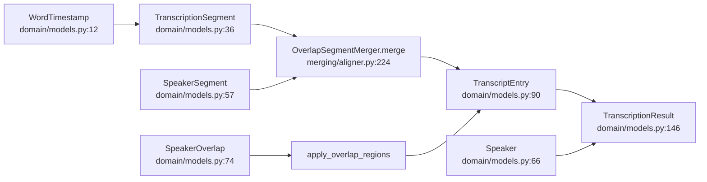

# Конвейер обработки

Навигация: [Обзор](README.md) · [Компоненты](components.md) · [Движки](engines.md) ·
[Веб](web.md) · [Конфигурация](configuration.md) · [Упаковка](packaging.md) ·
[Корп-режим](corporate-mode.md) · [ADR](decisions.md)

Центральная функция — `run_pipeline` (`pipeline.py:510`). Она строго
последовательна: каждая стадия начинается только после завершения предыдущей.

## 1. Порядок стадий

```mermaid
flowchart TB
    start(["run_pipeline(config)"]) --> pre["ensure_output_dir;<br/>resolve_device; build recognizer"]
    pre --> den{"denoise?"}
    den -- да --> denoise["DeepFilterDenoiser.denoise<br/>(CachingDenoiser)"]
    den -- нет --> asr
    denoise --> asr["ASR: transcribe(audio)<br/>[StageCache: asr]"]
    asr --> dia{"diarization_enabled?"}
    dia -- да --> diar["diarize(audio)<br/>[StageCache: diarization]"]
    dia -- нет --> enroll
    diar --> enroll{"references?"}
    enroll -- да --> enroll2["enrollment:<br/>assign_speaker_names"]
    enroll -- нет --> close
    enroll2 --> close["close denoiser<br/>(fixture cleanup)"]
    close --> merge["OverlapSegmentMerger.merge<br/>ASR + speakers → реплики"]
    merge --> clean["clean artifacts →<br/>collapse repeats → normalize text"]
    clean --> sent["SentenceMerger.merge"]
    sent --> split["SpeakerChangeSplitter.split"]
    split --> intra["collapse_intra →<br/>apply_overlap_regions →<br/>merge_same_name_speakers"]
    intra --> sent2["SentenceMerger.merge (снова)"]
    sent2 --> trim["trim_artifact_overlaps →<br/>assign_context_speakers"]
    trim --> corr{"enable_correction?"}
    corr -- да --> correct["MorphTextCorrector.correct"]
    corr -- нет --> llm
    correct --> llm{"llm_enabled?"}
    llm -- да --> post["run_llm_postprocess<br/>(имена/термины/резюме)"]
    llm -- нет --> build
    post --> build["TranscriptionResult"]
    build --> exp{"protocol_auto?"}
    exp -- да --> export["export каждый формат<br/>(+ timeline)"]
    exp -- нет --> samples
    export --> samples{"export_speaker_samples?"}
    samples -- да --> samples2["extract_speaker_samples"]
    samples -- нет --> done
    samples2 --> done(["emit done; return result"])
```



Ссылки на код (выборка контрольных точек): денойз `pipeline.py:602-609`;
ASR `:627-659`; диаризация `:665-733`; enrollment `:750-793`; закрытие денойзера
`:795-800`; объединение `:805`; очистка `:812-823`; склейка `:827`;
авторазделение `:840`; наложения `:853-856`; слияние одноимённых `:863-864`;
подрезка/контекст `:875-881`; корректор `:884-887`; LLM `:892-912`; результат
`:914-923`; экспорт `:926-945`; образцы `:953-979`; `done` `:981`.

Стадии, которые **отсутствуют**, если выключены: денойз, диаризация, enrollment,
очистка, автоисправление, LLM, экспорт (при `protocol_auto=False`). Каждая
необязательная стадия даёт **мягкую деградацию** и не роняет прогон.

### Порядок очистки vs склейки

Очистка (артефакты → повторы → нормализация) идёт **до** склейки предложений
(`:807-823`), чтобы корректор, LLM и экспорт работали с готовым текстом.
Авторазделение по смене говорящего (`:840`) идёт **после** первой склейки —
интервалы реплик уже финальны, а пословные метки позволяют точно рассечь
короткую вставку другого участника. Затем — повторная склейка (`:870`).

## 2. Поток данных доменной модели



- `TranscriptionSegment` — текст ASR без говорящего (`avg_logprob`,
  `no_speech_prob`, `words`).
- `SpeakerSegment` — интервал говорящего от диаризации.
- `TranscriptEntry` — финальная реплика: текст + `speaker` (+ `extra_speakers`
  для одновременной речи), `overlap`, `speaker_confidence`, признаки ручной
  правки (`edited`, `original_text`), `words`.
- `TranscriptionResult` — итог: `source_path`, `language`, `duration`,
  `entries`, `speakers`, `participants`, `summary`, `low_confidence_threshold`.

`SpeakerOverlap.speaker_ids` — участники зоны наложения; пустой кортеж означает,
что источник не сохранил участников (старый кэш) — зона годится для пометки
`overlap`, но имён не даст (`domain/models.py:74-82`).

## 3. Постадийный кэш

Реализация: `StageCache`, `cache/store.py:58`. Ключ стадии — SHA-256 от
стабильно сериализованного описания входа (`compute_cache_key`, `:41`):

```
SHA-256({
  "cache_version": CACHE_FORMAT_VERSION(=1),
  "stage": "asr" | "diarization" | "denoise",
  "source": { path, size, mtime_ns },   # cache/store.py:32
  "params": {...}
})
```

Попадание/промах — `load` (`:79`) / `save` (`:111`); аудио стадии
(`*.wav`) — `load_audio` (`:127`) / `save_audio` (`:139`); `clear` (`:182`).
Сериализация данных стадий — `cache/serialization.py` (`asr_payload:81`,
`diarization_payload:124`). При повреждении/несовместимости файла кэш
**игнорируется** и стадия пересчитывается (`cache/store.py:97-109`).

### 3.1. Ключ стадии ASR (`pipeline.py:315-391`)

- базовые: `engine` (имя класса), `backend`, `language`, `device`,
  `initial_prompt`, `hotwords`, `word_timestamps`;
- подпись денойза `denoise` (см. ниже);
- `whisper-cpp`: `whisper_cpp_model`, `whisper_cpp_threads`,
  `whisper_cpp_vad_model`, `whisper_cpp_chunk_seconds/overlap`,
  `asr_impl_version` (`= ASR_IMPL_VERSION = 7`, `whisper_cpp_engine.py:60`);
- `gigaam`: `gigaam_model`, `gigaam_model_path`, `gigaam_quantization`,
  `gigaam_vad`, `asr_impl_version` (`= 1`, `gigaam_engine.py:39`);
- faster-whisper: `model`;
- при `hybrid_asr`: блок `hybrid` с `impl_version` (`HYBRID_IMPL_VERSION = 1`,
  `transcription/hybrid.py:50`), `fallback_backend`, `fallback_model` и порогами.

### 3.2. Ключ стадии диаризации (`pipeline.py:407-489`)

Функция **намеренно не зависит от созданного движка** — ключ считается до
инициализации, чтобы попадание в кэш не запускало дорогой оценщик числа
говорящих и не грузило модель (`pipeline.py:415-422`). В ключ идут:

- `device`, `diarization_engine`, параметры nemo-speech
  (`nemo_speech_binary/model/device`), `num/min/max_speakers`;
- гиперпараметры pyannote (`min_duration_off`, `clustering_threshold`,
  `clustering_fb`), `pipeline` (`pyannote/speaker-diarization-community-1`,
  `diarization/pyannote_engine.py:24`), `local_model`;
- `diarization_impl_version` (`= 3`, `diarization/overlap.py:27`),
  `mark_overlap`;
- параметры маршрутизации `auto` + оценщика числа говорящих
  (`speaker_count_estimator_version = 1`, `diarization/speaker_count.py:70`);
- блок `hybrid` — только если маршрутизация может выбрать `hybrid`
  (`engine in ("auto", HYBRID_ENGINE)`) — иначе апгрейд гибрида не инвалидировал
  бы кэш pyannote/nemo-speech (`pipeline.py:466-480`); включает
  `hybrid_impl_version` (`= 7`, `diarization/hybrid_engine.py:100`);
- блок `sherpa` — только при `engine == sherpa`: `sherpa_impl_version`
  (`= 2`, `diarization/sherpa_engine.py:68`), собственные `threshold` и
  `linkage` (#133).

### 3.3. Подпись денойза (`pipeline.py:295-312`)

Ключ ASR и диаризации не использует настройку `config.denoise`, а использует
**факт** фактически применённого денойза: `{applied, key}`. DeepFilterNet при
недоступности/сбое молча отдаёт исходный файл, и тогда `applied=False`. Это
чинит рассинхрон кэша (#83): отключённый и деградировавший денойз дают
одинаковую подпись, и на вход ASR/диаризации попадает один и тот же файл.

### 3.4. Что кэшируется

- **Денойз** — `CachingDenoiser` (`cache/denoiser.py:28`), аудиофайл стадии;
  публикует `cache_key`, `last_hit`, `last_waveform`.
- **ASR** — сегменты + язык + длительность.
- **Диаризация** — сегменты + зоны наложения.

Общий `StageCache` создаётся один раз на прогон (`pipeline.py:575`), каталог —
`config.resolved_cache_dir()`; в web — `web-data/cache` (`web/config.py:317`).

## 4. Прогресс и отмена

### 4.1. Прогресс

`emit = on_progress or noop` (`pipeline.py:541`); события —
`ProgressEvent(stage, message, fraction, detail)` (`progress.py`). Стадия
«из кэша» сигнализируется явно через `detail="из кэша"` (`pipeline.py:609`,
`:643`, `:693`), а не эвристикой по времени. Полный список стадий для UI —
`web/estimates.py` (`STAGES`), веса/ETA — `StageEstimator`.

### 4.2. Отмена

`cancel_event: threading.Event` (`pipeline.py:527`). Проверка — в контрольных
точках `_ensure_not_cancelled` (`:492-507`) **перед и после каждой стадии**;
при срабатывании гасятся дочерние процессы (`terminate_all_processes`) и
поднимается `ProcessingCancelled`. Дочерние процессы — `whisper-cli`,
`llama-server`, `nemo-speech`, `deep-filter` (`utils/subprocess_registry.py`).

Ключевое свойство: **уже завершённые стадии остаются в стадийном кэше**, поэтому
повторный запуск возобновляется с них (`pipeline.py:536-538`; отмена в web:
`runner.py:470-476`).

## 5. Экспорт и «протокол»

- Автоматический экспорт выполняется, только если `config.protocol_auto=True`
  (`pipeline.py:926`). В web `protocol_auto` по умолчанию **False**
  (`web/config.py:385`) — стенограмма готова, а экспорт/резюме выполняются по
  кнопке.
- **Протокол встречи** — `generate_protocol` (`protocol.py:94`): пересчитывает
  резюме по текущей стенограмме (уже с именами говорящих), затем экспортирует
  во все `export_formats` (`:115-120`) и, если есть дорожки говорящих, строит
  HTML-таймлайн (`:122-126`). Возвращает `ProtocolArtifacts` (`:32`).
- **Образцы голоса** — `export_speaker_samples` (по умолчанию True в web,
  `web/config.py:241`): `extract_speaker_samples` (`pipeline.py:961`) сохраняет
  `*.speakers/<Имя>.wav` для прослушивания/enrollment; ошибка не роняет прогон
  (`:967-969`).

## 6. Единый waveform (декодирование аудио)

`_SharedWaveform` (`pipeline.py:109`) — однократное декодирование 16-кГц моно
waveform для всех стадий, которым нужно аудио (диаризация, enrollment,
извлечение образцов). Если денойз уже посчитал waveform, отдаётся он
(`pipeline.py:614-618`); иначе декодируется лениво **один раз** и
переиспользуется. Ошибка декодирования мягко деградирует до `None`.

## 7. Логирование

Каждая стадия пишет `logger.info` о начале и параметрах (например,
`pipeline.py:603`, `:646`, `:699`, `:813`). Для отладки таймлайна печатается
подробная сводка «кто когда говорил» (`pipeline.py:940`).
