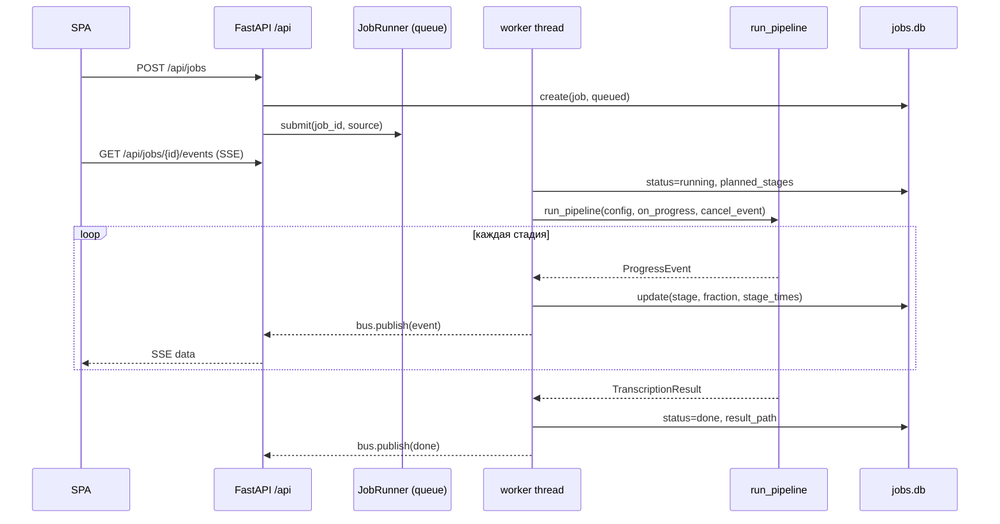

# Веб-слой

Навигация: [Обзор](README.md) · [Компоненты](components.md) · [Конвейер](pipeline.md) ·
[Движки](engines.md) · [Конфигурация](configuration.md) · [Упаковка](packaging.md) ·
[Корп-режим](corporate-mode.md) · [ADR](decisions.md)

Веб-интерфейс — надстройка над конвейером: FastAPI-приложение (`web/app.py`)
раздаёт REST API под `/api`, OpenAI-совместимый API под `/v1` и собранный React
SPA. Сервер поднимается только на `127.0.0.1` (`web/app.py:3`,
`cli/app.py:1413`) и **не имеет аутентификации SPA** — только CSRF-защита и
Bearer-ключ для `/v1`.

## 1. Сборка приложения и жизненный цикл

- `create_app(...)` (`web/app.py:718`) собирает всё окружение: `WebPaths`
  (`:750`), `SettingsStore`/`SecretsStore` (`:752-753`), `JobsDB` (`:754`),
  `JobEventBus` (`:756`), `DownloadBus` (`:757`), `ActionEventBus` (`:761`),
  `StageEstimator` (`:763`), установщики пакетов/бинарников (`:770-784`),
  менеджер скачивания моделей (`:829`), `JobRunner` (`:876`).
- `lifespan` (`:885-898`): при старте `reconcile_orphans()` + `runner.start()`;
  при остановке `runner.stop()` и гашение внешних процессов
  (`terminate_all_processes`).
- `serve(...)` (`web/app.py:4651`; вызывается из `cli/app.py:1471`) поднимает
  uvicorn. Порт: если `--port` не задан, подбирается свободный начиная с
  `DEFAULT_WEB_PORT` (`cli/app.py:1370-1407`).
- FastAPI: `docs_url="/api/docs"`, `openapi_url="/api/openapi.json"`
  (`web/app.py:900-906`).

## 2. Карта маршрутов

Роуты регистрируются в `register_api` (`web/app.py:1315`) на `APIRouter(prefix="/api")`
(`:944`); подроуты — в отдельных модулях (`register_glossary_routes`,
`register_prompts_routes`, `register_chat_routes`, `register_archive_routes`,
`:1462-1497`).

### 2.1. Система и настройки

| Метод | Путь | Строка |
|---|---|---|
| GET | `/api/health` | `:1506` |
| GET | `/api/config` | `:1512` |
| GET | `/api/asr/device` | `:1516` |
| GET / PUT | `/api/settings` | `:1530` / `:1546` |
| GET / POST / DELETE | `/api/api-key` | `:1607` / `:1612` / `:1640` |
| GET | `/api/doctor`, POST `/api/doctor/recheck`, `/api/doctor/hf-check` | `:1650` / `:1656` / `:1662` |
| POST | `/api/llm/check` | `:1675` |
| GET | `/api/setup`, `/api/deps` | `:1779` / `:1801` |
| GET | `/api/cache`, POST `/api/cache/clear` | `:2145` / `:2156` |

### 2.2. Установка ресурсов (пакеты/бинарники/модели)

- Библиотеки Python и внешние бинарники: GET `/api/deps` (`:1801`), POST
  `/api/deps/{key}/install` (`:1821`), SSE `/api/deps/events` (`:1845`);
  GET `/api/assets` (`:1891`), POST `/api/assets/{key}/install` (`:1900`),
  `/api/assets/install-all` (`:1950`), SSE `/api/assets/events` (`:2003`),
  DELETE `/api/assets/{key}` (`:2047`), `/api/assets/delete-all` (`:2074`).
- Модели: GET `/api/models` (`:2185`), SSE `/api/models/events` (`:2203`),
  POST `/api/models/{model_id}/download` (`:2217`), `/cancel` (`:2251`),
  DELETE `/api/models/{model_id}` (`:2276`).
- Модель nemo-speech: GET `/api/diarization/nemo-speech/detect` (`:1715`),
  `/model` (`:1736`), POST `/model/download` (`:1748`), SSE
  `/model/events` (`:1771`).

### 2.3. Файлы и задачи

- GET `/api/files` (`:2276`), POST `/api/files/upload` (`:2291`),
  DELETE `/api/files/{name}` (`:2295`), POST `/api/files/{name}/restore` (`:2320`).
- GET `/api/jobs` (`:2330`), POST `/api/jobs` (`:2337`),
  PATCH `/api/jobs/{job_id}` (`:2353`), GET `/api/jobs/{job_id}` (`:2375`),
  POST `/run` (`:2385`), `/cancel` (`:2416`), DELETE (`:2430`),
  `/restore` (`:2453`), GET `/result` (`:2460`).
- Правки стенограммы: PATCH `/transcript` (`:2468`), POST
  `/transcript/assign-speaker` (`:2506`), `/transcript/split` (`:2577`),
  `/transcript/extra-speaker` (`:2629`), `/apply-glossary` (`:2709`),
  `/correct-text` (`:2808`), `/protocol` (`:2947`), GET `/summary` (`:3003`),
  `/protocol/download` (`:3010`), `/export` (`:3026`).
- Говорящие/образцы: GET `/samples/{speaker_id}` (`:3067`), `/samples` (`:3082`),
  PATCH `/speakers` (`:3104`), POST `/apply-names` (`:3134`),
  `/speakers/{speaker_id}/variants` (`:3215`), `/to-library` (`:3244`),
  `/reassign` (`:3293`), `/speakers/undo` (`:3363`),
  GET `/audio` (Range, `:3373`), `/speakers/{speaker_id}/track` (`:3382`).
- Постановка задач с параметрами: POST `/api/jobs` создаёт задачу; число
  говорящих/язык/prompt хранятся в записи задачи (`web/storage/jobs_db.py:163`).

### 2.4. Голосовая библиотека, глоссарий, промпты, чат, архив

- `/api/voices` (`:3534` и далее): список, загрузка, аудио/огибающая образца,
  удаление, дедупликация (`/dedup`, `/dedup/merge`).
- `/api/glossary/*` — `register_glossary_routes` (`:1462`).
- `/api/summary-prompts/*` — `register_prompts_routes` (`:1463`).
- `/api/jobs/{job_id}/chat` — `register_chat_routes` (`:1477`).
- `/api/archive/*` — `register_archive_routes` (`:1497`).

### 2.5. Раздача SPA

- GET `/` (`:985`) отдаёт индекс SPA; GET `/{full_path:path}` (`:989`) —
  catch-all: отдаёт статический файл, если найден, иначе индекс. `/api/*` и
  `/v1/*` исключены из catch-all (`:991-994`).
- Собранная статика — `web/static` (`web/paths.py:25`). Если фронт не собран,
  отдаётся страница-заглушка.

## 3. SSE (Server-Sent Events)

### 3.1. `JobEventBus`

`JobEventBus` (`web/events.py:81`) — потокобезопасная in-process шина событий по
`job_id`. Мост из потока воркера в event loop FastAPI —
`loop.call_soon_threadsafe` (`events.py:110`), без блокирующих очередей на
запрос.

- `publish` (`:94`) нумерует события (`seq`, монотонно на задачу), пишет в
  историю и рассылает подписчикам; терминальное событие закрывает поток
  (`status in TERMINAL_STATUSES`).
- `history` (`:117`) отдаёт накопленное с фильтром `after` (`Last-Event-ID`).
- `open` (`:149`) — **атомарно** снимает историю и регистрирует подписчика под
  одним локом: события между ними не теряются (issue #85).
- `subscribe` (`:197`) — история (если `replay`) + живой поток.
- Heartbeat `DEFAULT_HEARTBEAT = 15.0` c (`events.py:27`): на таймауте отдаётся
  `None`, HTTP-слой превращает его в комментарий-пинг.

### 3.2. Формат кадра

`sse_frame` (`web/sse.py:35`): `seq` идёт как SSE-поле `id`, браузер сам вернёт
его в `Last-Event-ID` при переподключении. `parse_last_event_id` (`:46`)
разбирает заголовок; `stream_bus` (`:56`) отдаёт историю, затем живой поток;
`SSE_HEADERS` отключают кэш и буферизацию прокси (`sse.py:17`).

### 3.3. Эндпоинт задачи

`GET /api/jobs/{job_id}/events` (`web/app.py:3438`):

- терминальная задача → одно немедленное событие (`:3450-3468`);
- иначе: `bus.open(job_id, after=Last-Event-ID)` → история → свежий снимок из БД
  (после подписки, чтобы старый снимок не откатил прогресс) → живой поток
  (`:3470-3506`).

### 3.4. `ActionEventBus` (длительные действия)

Отдельная шина для действий, выполняемых **после** завершения задачи
(`apply-names`, `apply-glossary`, `correct-text`, `protocol`): `ActionEventBus` и
`ActionProgress` (`web/actions.py:61`, `:106`), типы действий
`ACTION_ENROLLMENT/GLOSSARY/CORRECTION/PROTOCOL` (`:52-55`). SSE —
`GET /api/actions/{action_id}/events` (`web/app.py:3512`); клиент генерирует
`action_id`, открывает поток и передаёт тот же id заголовком `X-Action-Id`.
Идентификатор санитизируется (`sanitize_action_id`, `web/actions.py:189`).

## 4. Очередь задач

`JobRunner` (`web/runner.py:152`) — **один** фоновый daemon-поток
(`runner.py:1-8`, `:190`). Задачи обрабатываются строго по одной: распознавание
и диаризация конкурируют за GPU/CPU.

- `submit` (`:216`) ставит задачу, `cancel` (`:228`) выставляет флаг отмены и
  гасит дочерние процессы текущей задачи, `reconcile_orphans` (`:258`) переводит
  «подвешенные» задачи прошлого процесса в `error`.
- `_process` (`:318`) собирает конфигурацию задачи (`config_builder`), фиксирует
  план стадий, вызывает конвейер; `_finish_success` (`:582`) сохраняет JSON
  результата в `results_dir/<job_id>.json` и переносит ручные правки текста
  (`merge_transcript_edits`, `:597`).
- Статусы: `queued`/`running`/`done`/`error`/`cancelled`
  (`web/storage/jobs_db.py:21-25`), терминальные —
  `TERMINAL_STATUSES` (`:28`).
- Успешный прогон помечает исходный файл обработанным
  (`_mark_source_processed`, `:667`).

## 5. Хранилища

`WebPaths` (`web/paths.py:29`) описывает каталог данных (по умолчанию
`web-data`, переопределяется `AUDIO_TRANSCRIBER_WEB_DATA`, `:19`):

| Свойство | Путь | Назначение |
|---|---|---|
| `jobs_db` | `web-data/jobs.db` | SQLite-очередь задач (`:58`) |
| `settings_json` | `web-data/settings.json` | редактируемые настройки UI (`:63`) |
| `prompts_db` | `web-data/prompts.db` | шаблоны промптов резюме (#97, `:68`) |
| `chat_db` | `web-data/chat.db` | история чата (#54/#96, `:73`) |
| `archive_db` | `web-data/archive.db` | архив + FTS5 (#99, `:78`) |
| `secrets_json` | `web-data/secrets.json` | токен HF/ключи, права 0600 (`:83`) |
| `input_dir` | `web-data/uploads` | загруженные/выбираемые файлы (`:88`) |
| `results_dir` | `web-data/results` | JSON-результаты и вывод стадий (`:93`) |
| `samples_dir` | `web-data/samples` | WAV-образцы голоса (`:98`) |
| `cache_dir` | `web-data/cache` | постадийный кэш (`:103`) |
| `bin_dir` | `web-data/bin` | автоустановленные бинарники (#98, `:53`) |
| `models_dir` | `web-data/models` (или env) | скачанные модели (`:48`) |

Глоссарий, промпты, чат и архив — **общие** предметные БД в `storage/`
(корневой пакет); в web-данных лежат их файлы (`prompts.db`, `chat.db`,
`archive.db`), а `glossary.db` — по `GLOSSARY_DB`/настройке
(`web/config.py:214-215`). `JobsDB` — web-специфичный (`web/storage/`).

`ArchiveDB` (`storage/archive_db.py:193`) создаёт виртуальную таблицу FTS5
`archive_fts` (`:268`) для полнотекстового поиска.

## 6. OpenAI-совместимый API (`/v1`)

`register_openai_api` (`web/app.py:1143`) монтируется **до** SPA-фолбэка
(`:972-983`), иначе catch-all перехватил бы `/v1/...`.

- `GET /v1/models` (`:1228`) отдаёт единственную модель
  `OPENAI_MODEL_ID = "whisper-1"` (`:340`).
- `POST /v1/audio/transcriptions` (`:1242`) принимает `file`, `model`,
  `language`, `prompt`, `response_format`, `temperature`,
  `timestamp_granularities[]`; создаёт задачу, **синхронно** ждёт завершения
  (`_await_openai_job`, `:1116`) и отдаёт результат в формате
  `json|text|srt|vtt|verbose_json` (`OPENAI_RESPONSE_FORMATS`, `:343`).
- Аутентификация строгая: `Authorization: Bearer <key>`, иначе `401`
  (`require_api_key`, `:1171`). Ключ берётся из `secrets.json`/`config.env`
  (`effective_api_key`) и **перечитывается на каждом запросе** (#110) — ключ,
  сгенерированный в UI, действует сразу.
- Таймаут синхронного ожидания — `OPENAI_TIMEOUT` (`DEFAULT_OPENAI_TIMEOUT =
  3600` с, `:347`), шаг поллинга `OPENAI_POLL_INTERVAL = 0.1` (`:350`).
- Ошибки `/v1/*` приводятся к формату OpenAI (`:1193-1224`).

## 7. CSRF и auth-заготовки

- **CSRF** (`csrf_guard`, `web/app.py:908`): для state-changing методов
  (`POST/PUT/PATCH/DELETE`, `_CSRF_UNSAFE_METHODS`, `:273`) отклоняет
  «межсайтовые» запросы (`_is_cross_origin`, `:276`): `Sec-Fetch-Site:
  cross-site` или `Origin` с чужим host. Политика **мягкая** — запросы без
  заголовков (CLI, тесты) проходят.
- **Bearer-ключ `/v1`** — единственная реализованная аутентификация
  (`web/secrets.py`: `effective_api_key`, `mask_secret`). Ключ генерируется в UI
  (префикс `sk-`, минимальная длина 16, `web/app.py:352-356`).
- **Логина SPA нет.** Сервер рассчитан на локальный запуск; TODO прямо
  предупреждает «не выставляйте его в сеть» (`TODO.md:745-746`).
- **Нет `AUTH_MODE`/SAML/RBAC** в коде — это предмет проектируемого
  корпоративного режима, см. [`corporate-mode.md`](corporate-mode.md).

## 8. Оценка прогресса/ETA

`StageEstimator` (`web/estimates.py`) считает прогресс и ETA по истории
завершённых задач; `planned_stages(config)` фиксирует план стадий
(`runner.py:394`). Список стадий `STAGES` используется как запасной, если
конфигурация не собралась (`runner.py:373-375`, `:1454`). Длительность исходной
записи определяется через `probe_duration` (`runner.py:334`).

## 9. SPA (React)

- Роутинг — **hash-роуты** (`webui/src/app/routes.ts`): `#/jobs`,
  `#/jobs/:id`, `#/archive`, `#/models`, `#/binaries`, `#/glossary`,
  `#/voices`, `#/settings`, `#/wizard` (`routes.ts:1-11`).
- Страницы: `webui/src/pages/*` (`JobsPage`, `JobPage`, `ArchivePage` и др.).
- API-клиент — `webui/src/api.ts`; SSE-подписки и обработка событий — в
  `webui/src/app/*` (например, `useAppController`, `jobUtils`).
- Стек: React 19, Vite, Tailwind CSS 4 (`webui/package.json`); сборка
  `tsc -b && vite build`, артефакт — `web/static`.

## 10. Перелинковка

Как конфигурация собирается для задач — [`configuration.md`](configuration.md);
как веб упакован и запускается — [`packaging.md`](packaging.md); как
предлагается добавить многопользовательский режим — [`corporate-mode.md`](corporate-mode.md).
